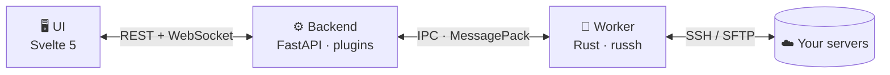

 

**We build tools for developers and DevOps engineers.** 
Student projects, done the grown-up way: pull requests, code review, CI on three operating systems and tests on every commit.

 

---

## 🛰️ Synex

**One window for your servers.** Synex is a desktop app that brings together an SSH terminal,
live monitoring, Docker, an SFTP file manager and git deploys — the things you would otherwise
juggle across five different tools.

| | |
|---|---|
| 🔐 **SSH** | Several sessions at once, encrypted key vault, saved connections, host key verification (TOFU) |
| 📈 **Monitoring** | CPU, RAM, disk, network and GPU in real time, streamed over WebSocket |
| 🐳 **Docker** | Containers at a glance: start, stop, restart, live logs |
| 📁 **Files** | Two-pane SFTP manager: whole folders, checksums, cancel at any time |
| 🚀 **Git** | Pull and deploy on the server in one click |

**Under the hood:** a microkernel. The core only provides the platform, the UI shell and a data bus;
every feature is a plugin you can switch on and off while the app is running.

<a href="https://github.com/ZeroDDP/Synex"><b>→ ZeroDDP/Synex</b></a>

---

## 👥 Team

<table>
  <tr>
    <td align="center" width="25%">
      <a href="https://github.com/Rinneway"> <b>Danil Tyustin</b></a> 
      Backend & logic
    </td>
    <td align="center" width="25%">
      <a href="https://github.com/MAGVANCHiK"> <b>Ivan Blinnikov</b></a> 
      Core (Rust)
    </td>
    <td align="center" width="25%">
      <a href="https://github.com/Prefifix"> <b>Ilya Kolesnikov</b></a> 
      Frontend
    </td>
    <td align="center" width="25%">
      <a href="https://github.com/appolsmirnykh-ship-it"> <b>Polina Smirnykh</b></a> 
      Design
    </td>
  </tr>
</table>

## 🛠️ How we work

- **`main` always works.** Changes land only through pull requests with green checks.
- **One task, one branch:** `backend/…`, `core/…`, `frontend/…`, `docs/…`.
- **Small, clear commits** in the imperative mood: *Add IPC client*, *Fix worker startup*.
- **Tests are part of the feature:** unit tests on Linux, Windows and macOS, integration tests against a real SSH server.

---

Tomsk Polytechnic University · School of Information Technology and Robotics Engineering (ESITR) · 2026

